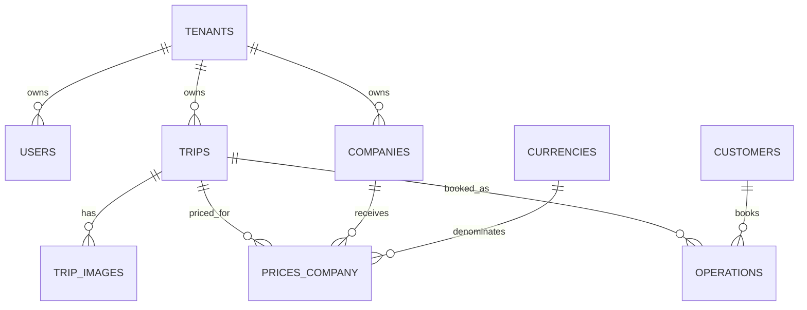

# MarinaX

MarinaX is a Laravel-based operations and business management platform for tour
operators. It combines trip and hotel management, customer bookings, staff and
resource operations, accounting, and tenant-specific website APIs.

## Features

- Multi-tenant companies with tenant-scoped business records.
- Separate Super Admin, administration, and staff areas.
- Trip catalog with descriptions, WebP image galleries, regions, inclusions,
  exclusions, FAQs, hotels, and company-specific prices.
- Tenant API keys with a `mx_live_` prefix, SHA-256 hash verification,
  expiration, revocation/rotation, configurable scopes, and one-time secret
  display after creation. Only a hash is retained.
- API last-use tracking, sanitized request/authentication logging, and
  API rate limits by client IP.
- Booking creation from a tenant website, with server-side prices, per-tenant
  idempotency keys, a booking lifecycle history, and a payment adapter seam.
  Website-created bookings start as `pending`; no payment is charged.
- Operations, accounting, vehicle/boat resources, staff access, and reports
  based on the existing application modules.

## Technology

- PHP 8.3+
- Laravel 13
- MySQL or SQLite
- PHPUnit 12 and Laravel Pint
- Vite for frontend assets

## Architecture

HTTP routes are divided between `routes/web.php` and `routes/api.php`.
Controllers coordinate requests and validation; Eloquent models represent
business data. Tenant identity is initialized by middleware and used by
tenant-aware models and `App\Support\TenantDatabase`. Shared data (such as
currency definitions and the shared chart of accounts) is deliberately kept
separate from tenant-owned data.



The diagram is a high-level view; consult `database/migrations` for the
authoritative schema and constraints.

## Installation

1. Install PHP 8.3+, Composer, Node.js/npm, and the PHP extensions required by
   Laravel and the configured database, including GD.
2. Install dependencies and create the environment file:

   ```sh
   composer install
   copy .env.example .env
   php artisan key:generate
   npm install
   npm run build
   ```

   On macOS/Linux, use `cp .env.example .env` instead of `copy`.
3. Configure the database in `.env`, then apply migrations:

   ```sh
   php artisan migrate
   ```

4. Create the initial Super Admin interactively:

   ```sh
   php artisan app:bootstrap-super-admin
   ```

5. Link public storage if trip images will be uploaded, then start the app:

   ```sh
   php artisan storage:link
   php artisan serve
   ```

The Super Admin login is at `/superadmin`. Do not run test-data seeders against
a production database.

## Configuration

Important environment settings (see `.env.example` for the full Laravel
configuration):

| Variable | Purpose |
|---|---|
| `APP_KEY` | Laravel application key; also used to HMAC idempotency keys |
| `APP_URL` | Public application URL used when generating links |
| `DB_CONNECTION` | Database driver, typically `mysql` or `sqlite` |
| `DB_HOST`, `DB_PORT`, `DB_DATABASE`, `DB_USERNAME`, `DB_PASSWORD` | Database connection |
| `FILESYSTEM_DISK` | Storage disk for uploads; trip images use the `public` disk |
| `QUEUE_CONNECTION` | Queue driver; defaults to `database` in `.env.example` |
| `CACHE_STORE`, `SESSION_DRIVER` | Cache and session storage |
| `MAIL_MAILER`, `MAIL_HOST`, `MAIL_PORT`, `MAIL_USERNAME`, `MAIL_PASSWORD`, `MAIL_FROM_ADDRESS` | Outbound mail configuration |
| `PAYMENT_PROVIDER` | Provider identifier; leave empty until a real adapter is installed |
| `PAYMENT_WEBHOOK_SECRET` | HMAC-SHA256 verification secret for the generic payment webhook |

Use a unique, private `APP_KEY` and `APP_DEBUG=false` in production. Keep `.env`
and all API keys out of source control. Back up the database and uploaded
storage together.

## Tenant Website API

The OpenAPI 3.0 contract and interactive Swagger UI are available at:

- `GET /api/documentation`
- `GET /api/openapi.yaml`

The documented tenant website API base path is `/api/v1`. Create or rotate a
tenant key from **Super Admin → Company APIs**, and pass the complete key using the
`Authorization` header:

```http
Authorization: Bearer mx_live_REDACTED
```

The full API key is shown only once at creation. Do not put the key in a URL,
query string, browser link, or client-side source code. Keep it on a trusted
server. Current API operations:

| Method | Path | Purpose |
|---|---|---|
| GET | `/api/v1/trips` | List active trips and their public website data |
| GET | `/api/v1/trips/{trip}` | Get an active trip |
| GET | `/api/v1/companies` | List active tenant companies |
| GET | `/api/v1/currencies` | List active currencies |
| POST | `/api/v1/bookings` | Create a pending booking |
| GET | `/api/v1/bookings/{booking}` | Read a booking summary |
| PATCH | `/api/v1/bookings/{booking}/status` | Change status with `bookings:manage` |
| POST | `/api/v1/bookings/{booking}/payments` | Request a provider payment intent |
| POST | `/api/v1/payments/{payment}/refund` | Request a provider refund |

The API is limited to 60 requests per minute per client IP; booking creation is
limited to 10 requests per minute per client IP. Authentication and request
logs never include the API secret. Use the `Idempotency-Key` header on booking
creation to safely replay successful requests. A reused key with a different
payload returns HTTP 409. Booking creation validates tenant ownership and
computes the amount from configured server-side prices.

The booking lifecycle is separate from legacy operations/accounting `status`
fields. New statuses are `pending`, `confirmed`, `paid`, `cancelled`, and
`refunded`, with allowed transitions and a history row. Payment endpoints return
503 until an actual `PaymentGateway` adapter is installed and configured. No
card numbers or CVVs are accepted or persisted. Payment webhooks use
`POST /api/webhooks/payments/{provider}` and HMAC-SHA256 with
`PAYMENT_WEBHOOK_SECRET`; they require the provider adapter and secret to be
configured. Webhook event IDs are idempotent.

The application also has session- and role-protected accounting JSON routes
under `/api/*`, registered in `routes/web.php`; they are internal dashboard
endpoints and are not part of this tenant website API specification.

## Development and tests

```sh
php artisan test
vendor/bin/pint --test
npm run dev
```

Feature tests use an isolated in-memory SQLite database. Do not point the test
environment at production data. The test suite also validates tenant isolation,
API key expiry, API documentation routes, booking creation, and management
flows.

## Queues and mail

The `.env.example` defaults to the database queue and Laravel's log mailer.
For a database queue in a deployed environment, migrate the queue tables if
they are not already present and run a worker, for example:

```sh
php artisan queue:work --tries=3
```

Configure a real mail transport only when outbound mail is ready. Booking and
payment notifications are queued to active tenant users using the configured
mail transport. WhatsApp has an interface seam only; no WhatsApp provider or
transport is configured.

## CI

GitHub Actions runs the Laravel test suite and Pint style check on pushes and
pull requests. It does not deploy to production.

## Screenshots

Screenshots are not included yet.

## Roadmap

- Payment-provider implementation and provider-specific webhook integration.
- Booking reminders and configurable notification channels.
- API request-log retention and administrative booking workflows.
- Expanded authorization, accounting, rate-limit, and payment tests.
- Static analysis after selecting a compatible tool and establishing a
  baseline.

## License

`composer.json` declares the MIT license. Confirm the repository owner's intent
before redistributing the project.
